# Lock architecture (as built)

This is how Lock is actually built today. The original design and its reasoning are in
[`Lock_High_Level_Detailed_System_Design.md`](Lock_High_Level_Detailed_System_Design.md); the choices
that turned the design into code are in [`decisions.md`](decisions.md) (cited as §n below); the
end-to-end encrypted tier is detailed in [`sealed-vault-design.md`](sealed-vault-design.md).

_Last updated: 2026-11-08 (roadmap through 3.11, 1.7, 4.2, 4.3, 5.1 and 5.2: Sealed format v2 and key
pinning, shared rate limits, offline sealed media, Expo SDK 58, docs CI, memory map with pin picker,
clustering and an all-vaults map)._

Diagrams are Mermaid, which GitHub renders inline. CI's `docs` job (`tools/docs-check`) parses every
diagram in `docs/` with Mermaid itself, so a diagram that wouldn't render fails the build.

---

## 1. System context

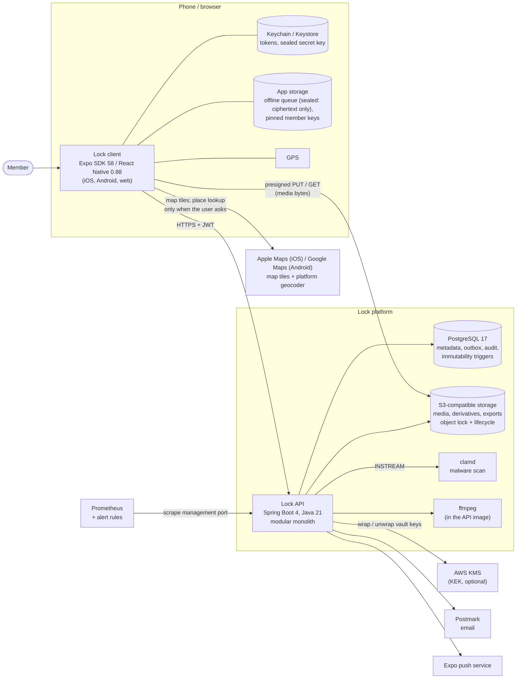

Media never passes through the API: the client uploads and downloads directly with short-lived
presigned URLs that the API issues only after checking access (design §11, invariant 5). The maps
provider sees map views and, only on request, the place names being looked up; never stored
positions, which go to the API encrypted (decisions §27).

## 2. Backend modules

One deployable, split into packages that talk only through services (decisions, Stack). Each could
become its own service later; the outbox is the seam for that.

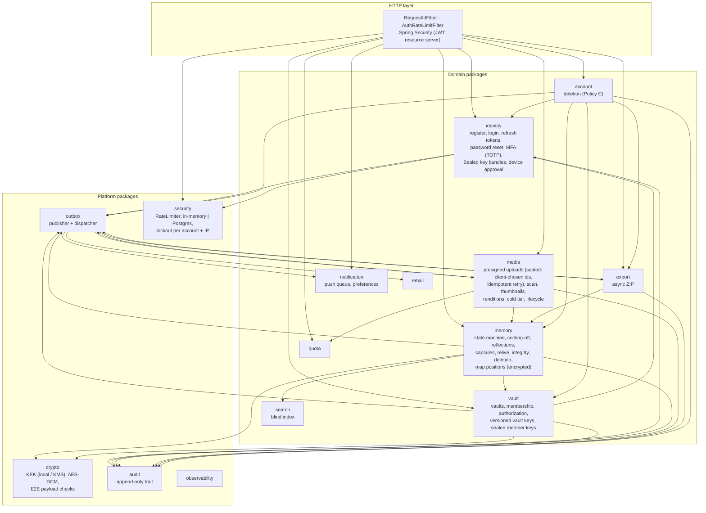

## 3. Data model

Main tables (Flyway `V1`–`V21`; V18 clears sealed search-skip rows, V19 adds `vault_member_keys.wrapped_by_public_key`, V20 adds `rate_limit_hits`, V21 adds `memories.coordinates_ct`). Rows marked _immutable_ are guarded by database triggers as well
as by the services.

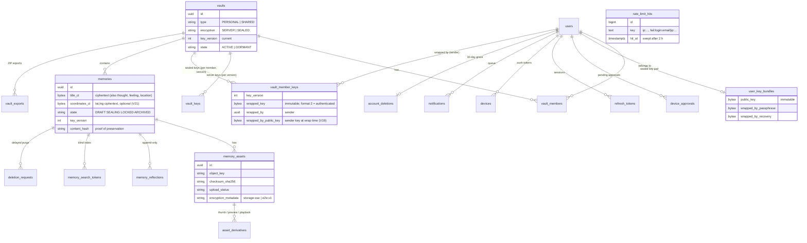

Also: `audit_events` (append-only), `outbox_events`, `user_mfa`, `mfa_recovery_codes`,
`password_reset_tokens`, `notification_preferences`, `search_index_skips` (server backfill only; for a
sealed memory a skip row means "the device found no words", V18). `rate_limit_hits` (V20) stands alone:
its keys name an IP or an account, not a foreign key.

## 4. Memory lifecycle

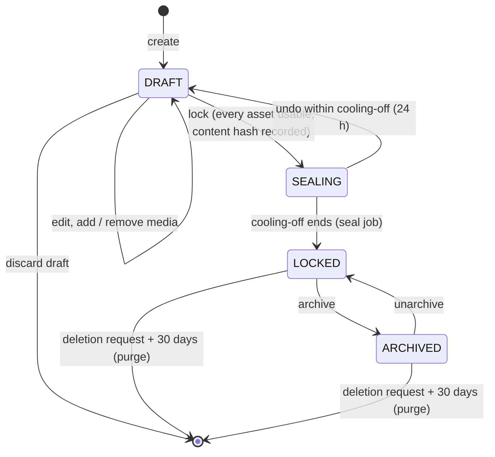

From SEALING onward the content columns (including the map position, `V21`) and the memory's assets
can't change: `MemoryService` refuses, and the `V1`/`V13`/`V21` triggers refuse again at the database.
The content hash includes the map position only when one is set, so proofs made before `V21` still
verify. Reflections are append-only.
Locking publishes `memory.locked`, which applies S3 object-lock retention (governance mode).

## 5. Media upload

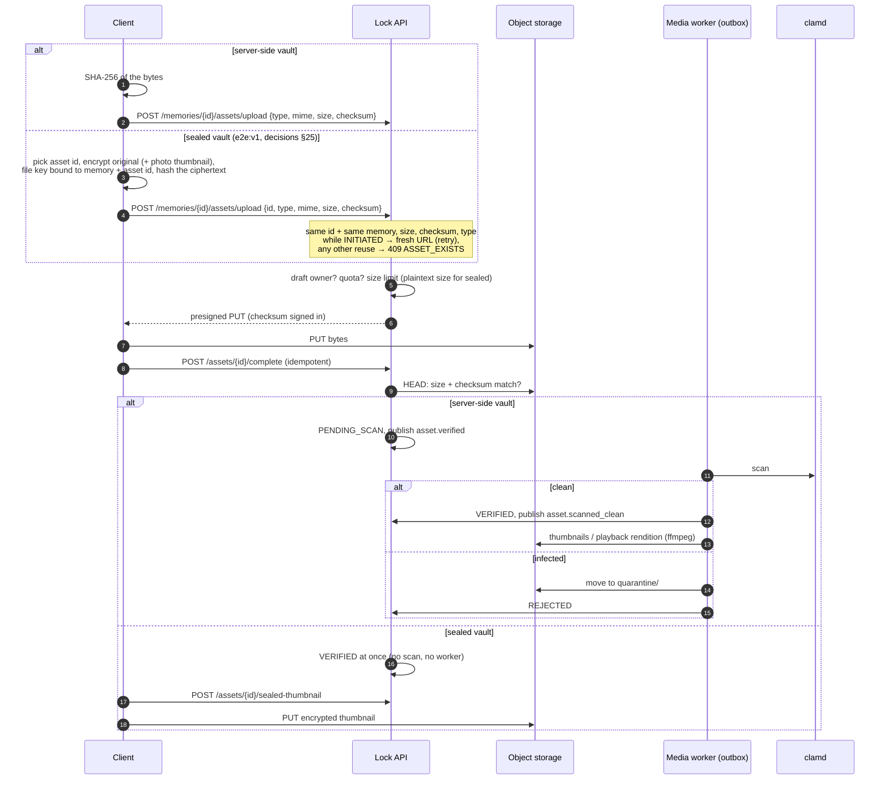

Upload states: `INITIATED → PENDING_SCAN → VERIFIED → ATTACHED` (at lock), or
`VERIFICATION_FAILED`, `REJECTED`, `EXPIRED` (never completed within the window).

### Offline and background upload (client, roadmap 3.5, 3.9, 3.10)

On native the client never uploads straight from the picker: every draft and file goes through a
persistent queue first, so it survives going offline or the app being closed. Sealed vaults put only
ciphertext in the queue.

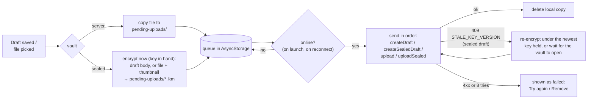

## 6. Events and background work

Domain events are written to `outbox_events` in the same transaction as the change, then dispatched
by `OutboxDispatcher` every 5 seconds (`FOR UPDATE SKIP LOCKED`, retries, dead-letter count). No event is lost if the
process dies, and none is sent for a rolled-back change.

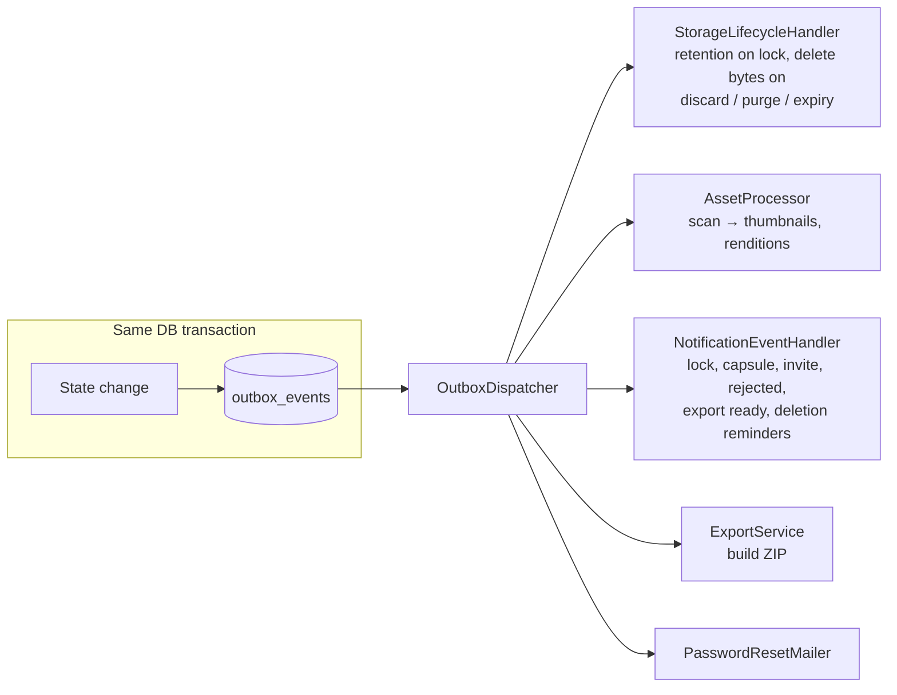

Scheduled jobs (each claims its batch with `SKIP LOCKED`, so several instances share the work):

| Job | Every | Does |
|---|---|---|
| `LifecycleJobs` | 1 min / 15 min / 30 min / 6 h | complete seals, execute due deletions, expire stale uploads, delete expired refresh tokens |
| `NotificationJobs` | 30 s; daily 09:00 UTC | send queued push notifications; enqueue "on this day" |
| `AssetProcessor` sweeps | 5 min / 30 min | re-scan stuck uploads; backfill missing derivatives |
| `ColdTierJob` | 6 h | tag old originals for the cold tier (if enabled) |
| `SearchBackfillJob` | 15 min | index memories written before search existed (sealed vaults excluded by query; devices re-index those via `GET /vaults/{id}/search/unindexed`) |
| `VaultKeyRewrapper` | 10 min | re-wrap vault keys after a KEK rotation |
| `AccountDeletionJob` | 15 min | execute account deletions after the grace period |
| `ExportService.housekeeping` | 1 h | delete expired export archives |
| `DeviceApprovalService.deleteExpired` | 15 min | drop device approvals older than 10 minutes |
| `ScannerProbe`, `LifecycleRuleCheck` | 1 min / 6 h | feed the `lock_scan_up` and `lock_storage_exports_lifecycle` gauges |
| `PostgresRateLimiter.sweep` | 10 min | delete rate-limit hits older than 2 h (Postgres store only; idempotent, no lock needed) |

## 7. Encryption

Two vault types share one schema. A vault's type is chosen at creation and never changes.

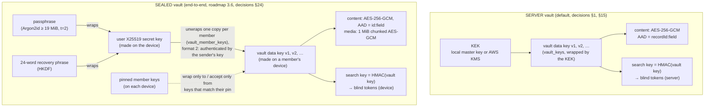

- **Rotation:** removing a member (or a member leaving) bumps `vaults.key_version`. New content uses
  the new version; old content keeps its version, because re-encrypting locked ciphertext would break
  immutability and the integrity proof (§15). Sealed vaults: the next member device to open the vault
  generates the new version and must wrap it for every remaining member at once.
- **What the server can do:** for SERVER vaults it decrypts to serve content, build exports, index
  search and make thumbnails. For SEALED vaults it stores and returns ciphertext only and refuses
  plaintext (`PLAINTEXT_IN_SEALED_VAULT`); thumbnails, search tokens and exports are made on the device.
- **Sealed key sharing (format 2, security review F1/F2):** each wrapped copy is authenticated by the
  wrapping member's X25519 key, and every device pins each member's key on first sight. See the sequence
  below and [`sealed-vault-protocol.md`](sealed-vault-protocol.md) for byte layouts.
- **Password reset** restores the account and every SERVER vault; a SEALED vault needs the passphrase,
  the recovery phrase or an approved device.

### Opening a sealed vault: authenticated keys and pins (roadmap 3.8)

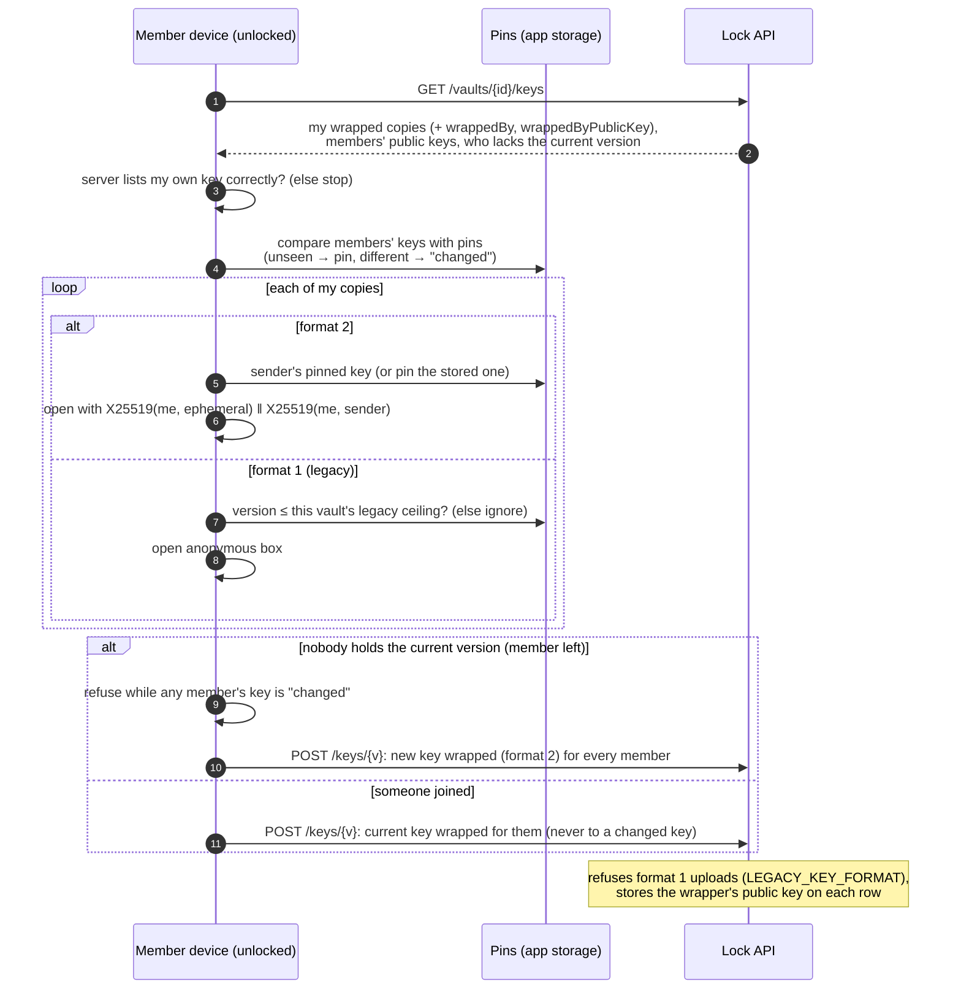

A changed key is resolved in Members: the user compares fingerprints in person, then accepts the new
key. Members can also be marked "Verified in person".

### Approving a new device for sealed vaults (roadmap 3.6e)

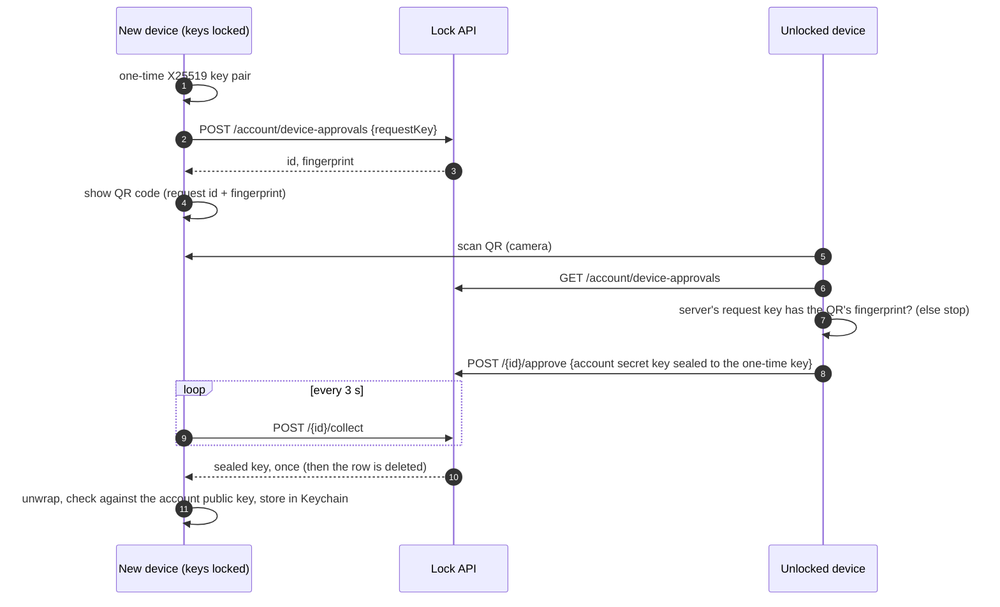

The fingerprint comparison is what stops the server, or someone with a stolen access token, from
inserting its own request key.

## 8. Request security

- **Authentication:** 15-minute HS256 access JWTs plus rotating 30-day refresh tokens with reuse
  detection (a reused token revokes the whole family). Optional TOTP second step with recovery codes;
  sensitive actions (deletions, exports, key bundle changes) need the password and, if MFA is on, a code.
- **Authorization:** every vault call checks active membership in the database; non-members get 404 so
  vault ids can't be probed. Drafts are visible only to their creator.
- **Abuse:** per-IP limits on auth endpoints. Wrong passwords lock out the guessing IP for that account
  (5 in 15 min), with an account-wide backstop across all IPs (50). Counters live in Postgres
  (`rate_limit_hits`, `PostgresRateLimiter`) so every instance shares them; development can use memory.
- **Production guard:** the `prod` profile refuses to start with dev secrets, the dev malware scanner,
  the log-only email sender, or per-instance rate limits (`ProductionSecretsGuard`).

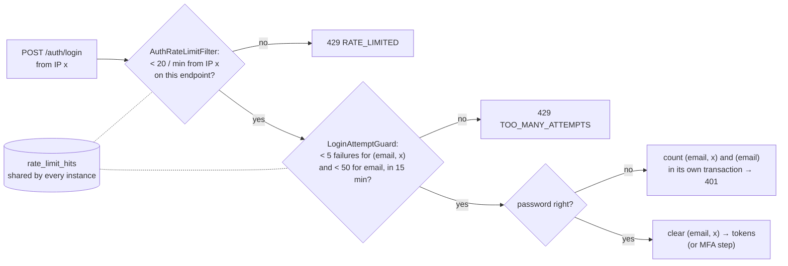

Counting per (account, IP) means a stranger guessing from their own machine can't lock the owner out
(decisions §26). A password reset clears every IP's count for the account.

## 9. Deployment and operations

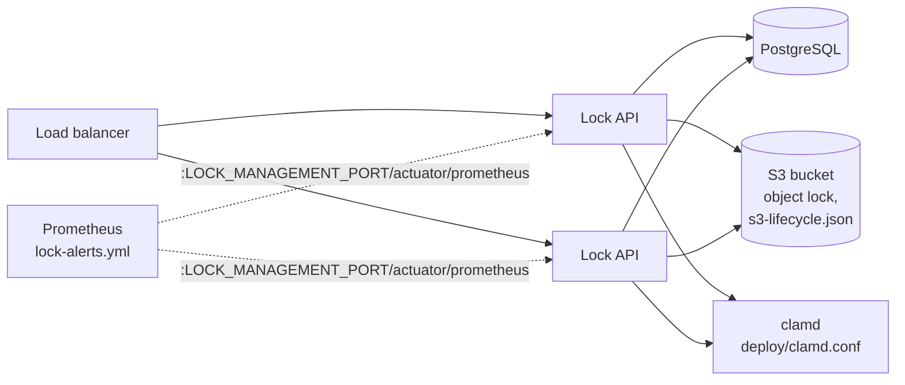

- **Instances:** stateless; any number can run. Jobs and the outbox share work through
  `SKIP LOCKED`. Rate limits and lockouts are shared through Postgres (`LOCK_RATE_LIMIT_STORE=postgres`).
- **Configuration:** `deploy/production.env.example` lists every production variable;
  `deploy/README.md` has the checklist.
- **Health:** `/actuator/health/readiness` checks the database and storage; `/liveness` is separate.
- **Metrics and alerts:** Prometheus scrapes the private management port. Alert rules in
  `deploy/prometheus/lock-alerts.yml` cover the scanner (down, stuck, growing backlog), the exports
  lifecycle rule, the outbox (dead events, lag), seal lag, integrity failures and stale KEK wrapping.
  `AlertRulesTest` fails the build if a rule uses a metric the API doesn't export.
- **Logs:** one JSON object per line with `LOCK_LOG_FORMAT=ecs`; every line carries the request id.
  No tokens, passwords or decrypted content are logged.

## 10. Client

```
client/src/
  app/          screens (Expo Router); _layout.tsx guards signed-in routes with Stack.Protected
  api/          client.ts (fetch, single-flight token refresh), lock.ts (every endpoint), types.ts
  theme/        design tokens (light/dark palette, spacing, radius); minimalist design system (roadmap 4.1)
  components/   UI kit (ui.tsx), AssetGallery (incl. sealed tiles), MediaPlayer (expo-video),
                MemoryMap (expo-maps, clustering; *.web.tsx renders nothing), MemoriesMapView (map + place list),
                PinPicker (crosshair pin picker; none on web), SealedGate, QrCode, MemoryForm
  lib/
    session.tsx, tokenStore.ts   auth state; tokens in SecureStore (sessionStorage on web)
    offlineQueue.ts               offline drafts + background uploads (sealed vaults: ciphertext only)
    push.ts                       push registration and taps
    cryptoRandom.ts               secure randomness for @noble/* on native; imported first
    sealed.ts                     E2E crypto: key pair, passphrase/phrase wraps, vault-key boxes, fields
    sealedMedia.ts                chunked media encryption format
    sealedSearch.ts               on-device blind index (port of SearchTokenizer)
    sealedVault.ts, sealedDecrypt.ts, useSealed.ts   keys on this device, open vault, encrypt/decrypt, re-index older memories
    keyPins.ts                    pinned member keys (trust on first use, changed-key refusal, verified flag)
    geo.ts                        map positions: GPS fix, on-device geocoding, map camera, clustering (5.1, 5.2)
    mapData.ts                    map loaders: one vault, or every vault the device can read (5.2)
    sealedFiles.ts, sealedExport.ts                  streaming file encryption, chunk-streamed ZIP export, cache sweep
    deviceApproval.ts             QR device approval
```

The client runs on Expo SDK 58 (React Native 0.88). Sealed vault keys are wrapped with the
authenticated format v2, and member keys are pinned on each device (`docs/security-review-sealed-vault.md`;
byte-level specification: `docs/sealed-vault-protocol.md`).

Server state goes through TanStack Query. Sealed content is decrypted inside the API wrappers, so
screens see plaintext once the device holds the key and an "Encrypted" placeholder otherwise.

### Memory map (roadmap 5.1)

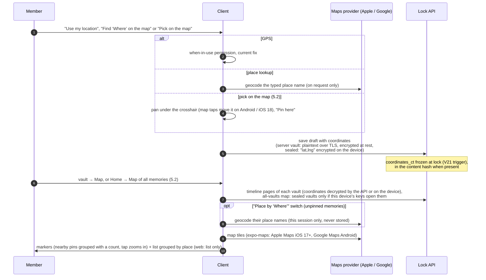

Android builds need `GOOGLE_MAPS_ANDROID_API_KEY` (read by `client/app.config.ts`); iOS needs no key.
